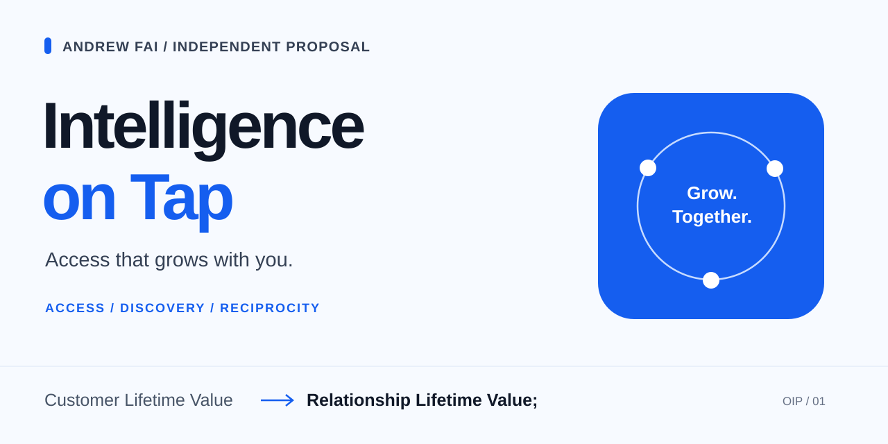

# [OIP] OpenAI Improvement Proposal - Intelligence on Tap

**An independent proposal by Andrew Fai.**

An optional **$20 membership plus metered intelligence**, alongside fixed plans.

## [Live payment UI prototype&nbsp;→](https://intelligence-on-tap-andrew-fai.andydrewie.chatgpt.site/#billing)

Change usage. Inspect the bill. Try an optional donation. **This is a demonstration; no payments are collected.**



## Customer Lifetime Value → Relationship Lifetime Value;

What if access to intelligence could grow with a person, and the relationship could grow with what they create?

Tibo's $50 Pro question prompted this additional option. The existing $100, $200 and $500 plans can stay. The larger ambition is an AI native Renaissance in which more people can build, discover and contribute. **Commercial viability and broader access remain hypotheses to test.** This repository does not demonstrate superintelligence or its democratization.

### Read the thinking

- **[Read the proposal](docs/PROPOSAL.md)** for the idea, its scope and the questions worth testing.

- **[Explore Relationship Lifetime Value](docs/RELATIONSHIP-LIFETIME-VALUE.md)** for the university-inspired ecosystem: useful work, shared knowledge, new enterprises and voluntary giving, each with its own consent requirements.

## What else can I explore?

The live prototype has four views. Start with **The bill** above, then choose a question:

- **[The economics: what must the service fund?](https://intelligence-on-tap-andrew-fai.andydrewie.chatgpt.site/#economics)**
  Costs start unknown. Enter assumptions, review them for the current usage and inspect the signed balance. This does not estimate OpenAI's profit.

- **[The relationship: how could loyalty grow?](https://intelligence-on-tap-andrew-fai.andydrewie.chatgpt.site/#relationship)**
  Explore loyalty, purpose-specific consent and separately agreed partnership. Evidence selection is a preview; it does not connect accounts or authorize investment access.

- **[The reasoning: where did the ideas come from?](https://intelligence-on-tap-andrew-fai.andydrewie.chatgpt.site/#research)**
  Search ten chapters, follow source passages and inspect the proposal's evolution. The [repository research guide](docs/RESEARCH.md) is the starting point for evaluating its claims.

The receipt also includes a formula drawer, boundary examples and scenario links. Usage and donation stay together when you move between views; a change in usage requires a fresh review of cost assumptions.

## The billing equation

All amounts are USD. Let **M** be nonnegative metered usage and **S** the subtotal, including the $20 membership:

```math
S=20+M
```

The adopted rule settles that subtotal into the service bill **B(S)**:

<!-- Equivalent to settlementLatex in lib/equations.mjs; comparison commands protect GitHub rendering. -->
```math
B(S)=\begin{cases}
20, & 20\le S\le60,\\
100, & 60\lt S\le150,\\
200, & 150\lt S\le350,\\
500, & 350\lt S\le500,\\
50\left\lfloor\dfrac{S+25}{50}\right\rfloor, & S\gt 500.
\end{cases}
```

In words: settle to $20, $100, $200 or $500 in the ranges above, then round to the nearest $50 above $500. Named-tier midpoint ties settle lower; $50-band midpoint ties settle upward. Comparisons use integer cents. A voluntary donation is added **after** settlement and excluded from service revenue.

**Example:** $20 membership + $86.40 usage = $106.40 subtotal → **$100 service bill**, before any donation.

The sharp boundaries matter: $350.00 settles to $200, while $350.01 settles to $500. A $525 subtotal settles to $550. These are intentional consequences of the adopted concept, not a production-ready pricing recommendation.

- [Inspect the exact economics, examples and tradeoffs](docs/ECONOMICS.md).
- [Read the implementation](lib/model.mjs) or [settlement regression tests](tests/settlement.test.mjs).

## Inspect or build

- **[Interaction state map](docs/INTERACTIONS.md)**: 17 interface families, their owners, transitions, recovery and verification limits.

- **[Development guide](docs/DEVELOPMENT.md)**: architecture, local setup and reproducible checks.

- **[Agent entry point](AGENTS.md)**: project constraints and bounded paths into contracts and evidence.

### Run locally

Requires Node.js 22.13 or later; Node 24 is the verified environment. Python 3 is needed for packaging checks.

```sh
git clone https://github.com/andydrewie/oip-intelligence-on-tap.git
cd oip-intelligence-on-tap
npm ci
npm run dev
```

Open the local address printed by the server. No application secrets or external account connections are required.

## Evidence and limits

OpenAI already offers [usage credits for eligible ChatGPT features](https://help.openai.com/en/articles/12642688-using-credits-for-flexible-usage-in-chatgpt-personal-plans). This proposal explores the combined billing experience, relationship model and inspectable evaluation framework; it does not claim to invent metering.

The repository contains **93 automated tests**, the unchanged 572-paragraph historical source corpus and a [100-case interaction record](review/state-machines/REVIEW.md). That record has 97 passes and 3 not run, including retained baseline evidence. It is not 100 fresh browser tests. The [GitHub presentation review](review/github-presentation/REVIEW.md) records this revision's separate checks and remaining device checks.

Provider costs, loyalty effects, customer outcomes, investment returns and access improvements have not been established. The [sources and claims guide](docs/SOURCES.md) distinguishes evidence from assumptions.

## Contribute

- [Suggest an improvement](CONTRIBUTING.md).
- [Report a defect or challenge a claim](https://github.com/andydrewie/oip-intelligence-on-tap/issues/new/choose).
- [Cite this work](CITATION.cff).

“OIP” is Andrew's label for this independent contribution, not an official OpenAI process, endorsement, product or offer. No official donation channel is established here.

Original code is [MIT](LICENSE); Andrew's original writing is dedicated under [CC0 1.0](CONTENT-LICENSE.md). Third-party assets retain their own rights. The application is the [Sites version 20 snapshot](SOURCE_PROVENANCE.json); GitHub publication does not automatically deploy the live site.

**Take what is useful. Challenge what is uncertain.**
